# drupal-qa

**CI for Drupal sites on Pantheon.** Every pull request gets its own Pantheon
environment, deployed and smoke-tested, with the result of every step posted on the
pull request.

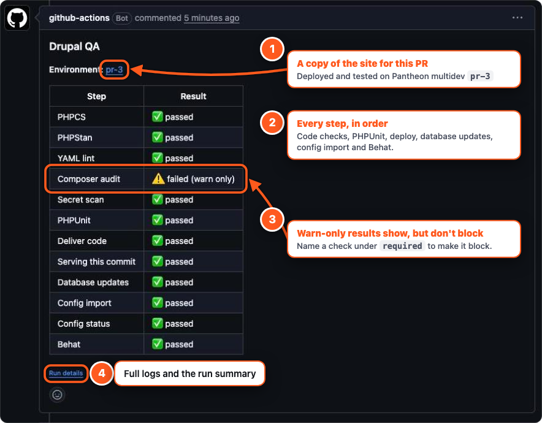

## TL;DR

In the site's folder:

```bash
bash <(curl -fsSL https://raw.githubusercontent.com/DanePete/drupal-qa/main/bin/drupal-qa-setup)
```

Or starting from nothing, in a new folder; the wizard offers to pull the site down from Pantheon:

```bash
mkdir -p ~/drupal-qa-setup && cd ~/drupal-qa-setup && bash <(curl -fsSL https://raw.githubusercontent.com/DanePete/drupal-qa/main/bin/drupal-qa-setup)
```

Rather do it by hand? Every step is in [Manual installation](#manual-installation).

**Out of the box:** 6 code checks, 7 deploy checks, 24 smoke tests and 10 project-health
tests. [See every one](#tests-included-out-of-the-box).

The setup wizard installs the package, writes the workflow, connects GitHub, sets both
secrets, adds the SSH key to Pantheon, opens the first pull request and watches it run.

- It works out what it can and asks the rest.
- It never prints a secret and never force-pushes.
- Run it again at any point: it skips what's done. `--dry-run` changes nothing.

**In this README:** [the wizard, stage by stage](#the-wizard-stage-by-stage),
[the tests included](#tests-included-out-of-the-box), [what blocks a merge](#what-blocks-a-merge),
[adding your own tests](#adding-your-own-tests), the [reference](#reference), and
[manual installation](#manual-installation).

## The wizard, stage by stage

Ten stages. Each one says why it's there, checks what's already done, and asks before
it changes anything. The screens below are from a made-up site, `acme-site`.

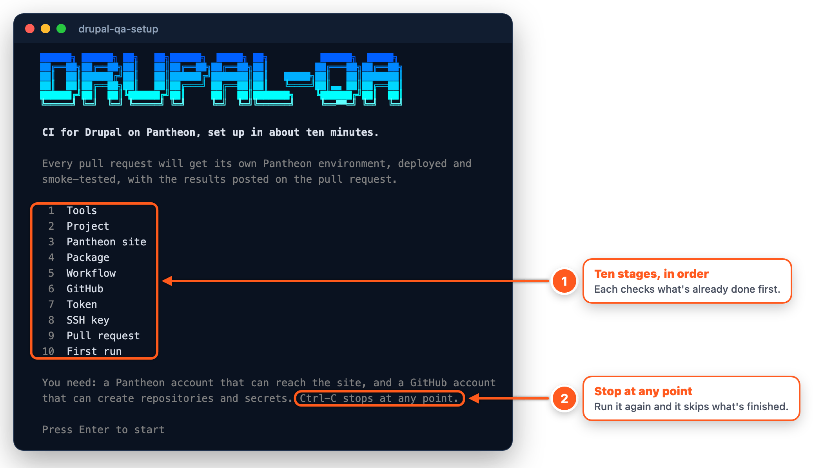

### Find the site

In an empty folder it lists your Pantheon sites and clones the one you pick. In a
project folder it finds the site from the git remote.

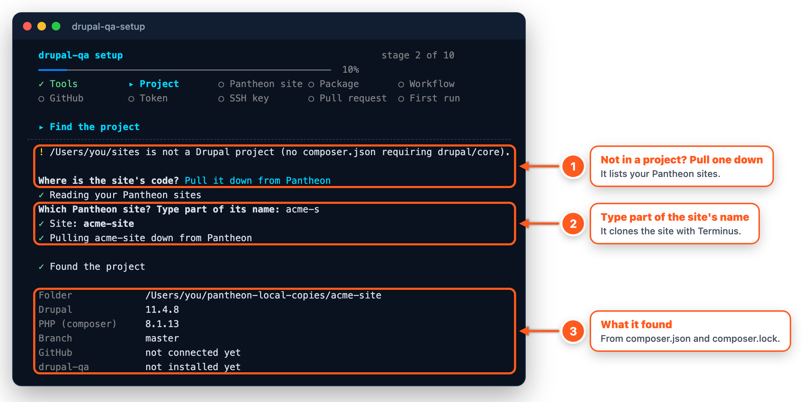

<details>
<summary>Stage 3: the Pantheon site</summary>

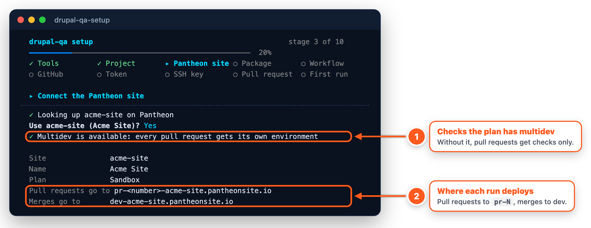

</details>

### Install the package

It installs `thronedigital/drupal-qa` and Drupal's own test tools, matched to your
core. An old PHP pin in `composer.json` is raised to what Pantheon runs, and if
Composer needs `-W`, it explains why and asks first.

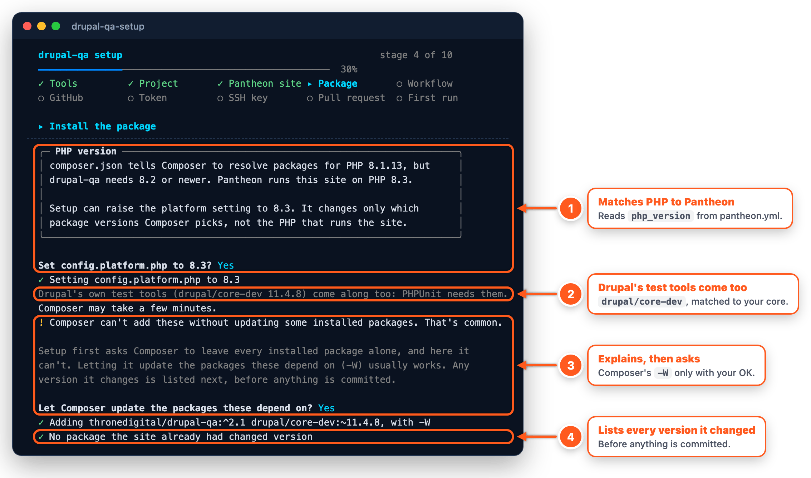

<details>
<summary>Stage 5: the workflow file</summary>

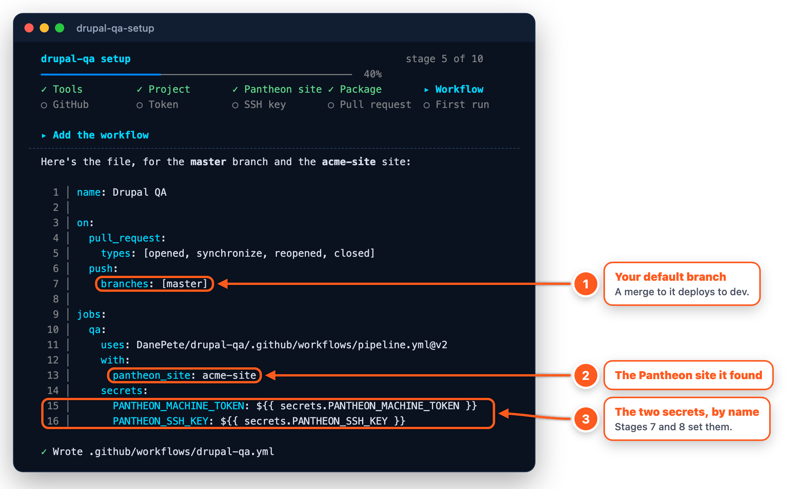

</details>

### Connect GitHub

It uses the repository the project already has, or makes one under your account or an
organization. A taken name is adopted only if its history lines up with yours.

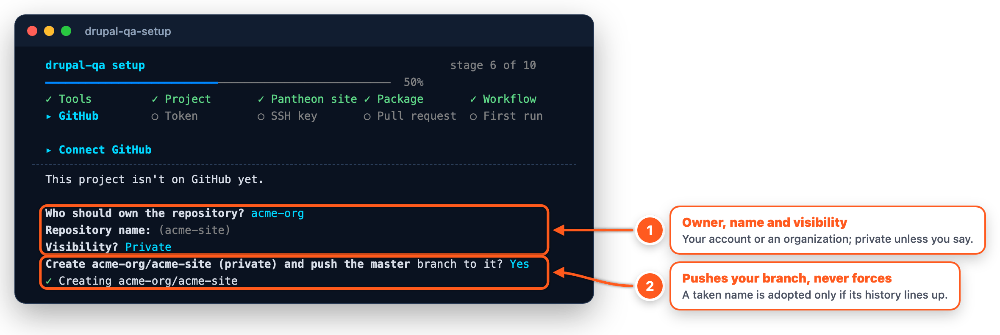

### Add the two secrets

It opens Pantheon's token page, takes the token with hidden input, checks it with
Pantheon and saves it as a GitHub secret. Then it makes an SSH key just for drupal-qa.

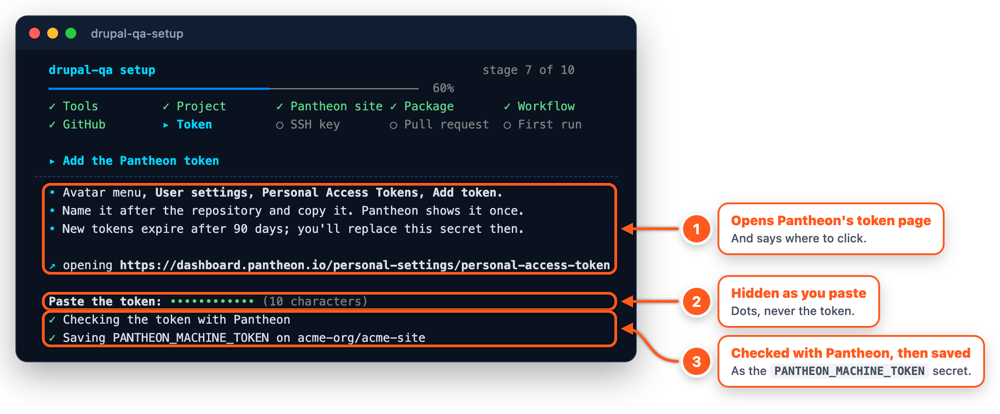

<details>
<summary>Stage 8: the SSH key</summary>

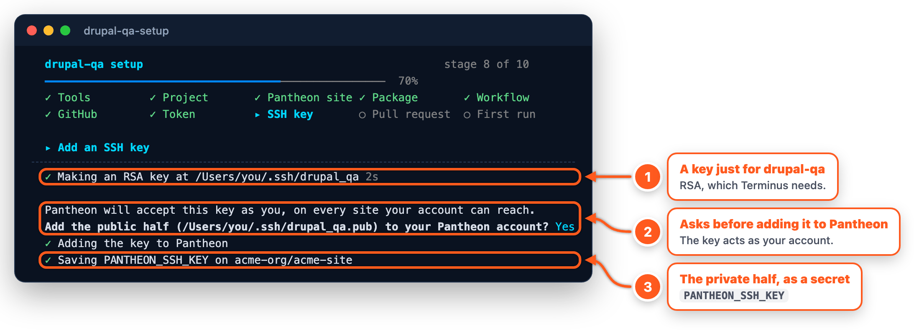

</details>

### Open the pull request

Type a phrase that must always be on the home page and it writes your first test. It
shows what it will commit, then opens the pull request.

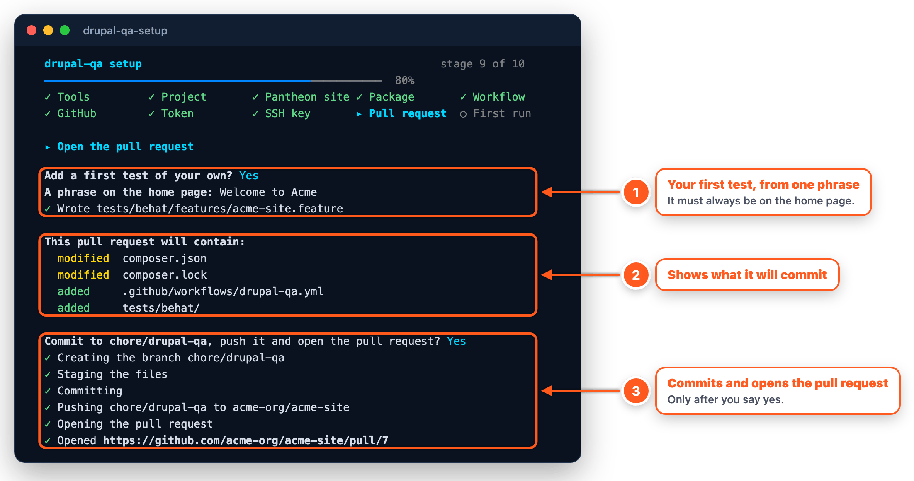

### Watch the first run

A live board of the run's jobs, then every step's result. The first run takes 10 to 15
minutes, most of it Pantheon building the multidev.

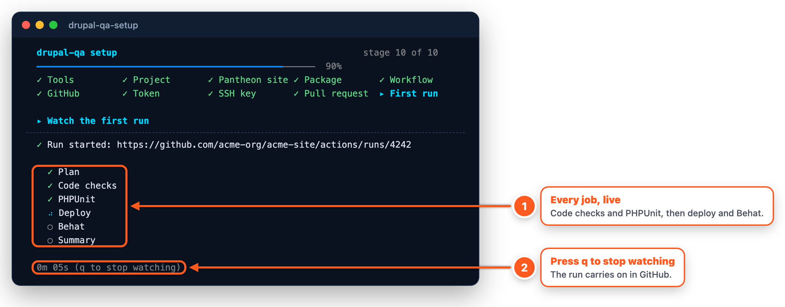

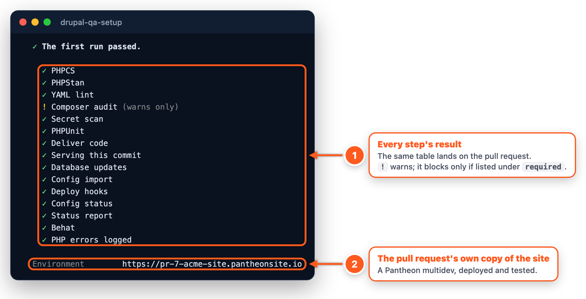

## Tests included out of the box

Every site gets all of this without writing a single test: **6 code checks, 7 deploy
checks, 24 smoke tests** (18 on every site, 6 more where a module is on) **and 10
project-health tests**, plus a check for PHP errors while they run.

| When | What happens |
|---|---|
| **Pull request** opened or pushed | Code checks and PHPUnit, then a multidev `pr-N`, database updates, config import and smoke tests against it. The results land on the pull request. |
| **Merge** to the default branch | The same, against `dev`. |
| **Pull request closed** | `pr-N` is deleted. |

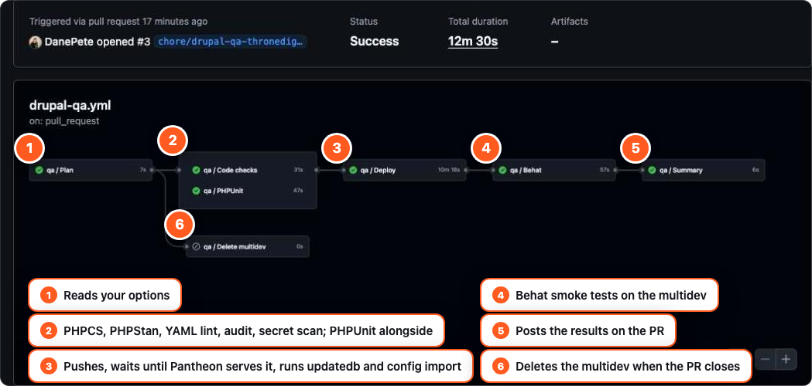

### 1. Code checks: 6

Run on the code, in GitHub.

| Check | What it does | By default |
|---|---|---|
| PHPCS | Drupal coding standard on custom modules, custom profiles and every theme that isn't contrib. Errors only; line length isn't checked. | warns |
| PHPStan | Level 1 with `phpstan-drupal` and deprecation rules, on the same paths | warns |
| YAML lint | Syntax errors and duplicate keys in the config sync directory | warns |
| Composer audit | Dependencies with known security advisories | warns |
| Secret scan | Passwords and keys in the commits this change adds ([gitleaks](https://github.com/gitleaks/gitleaks)) | warns |
| PHPUnit | Your Unit and Kernel tests, plus drupal-qa's 10 [project-health tests](#4-project-health-tests-10), with a MariaDB for Kernel tests | **blocks** |

### 2. Deploy checks: 7

Put the code on the pull request's multidev, or on `dev` after a merge.

| Check | What it does | By default |
|---|---|---|
| Deliver code | Pushes to Pantheon, creating `pr-N` first (from live, or from dev if live isn't initialized) | **blocks** |
| Serving this commit | Waits until the environment serves a file from this exact commit | **blocks** |
| Database updates | `drush updatedb` | **blocks** |
| Config import | `drush config:import` | **blocks** |
| Deploy hooks | `drush deploy:hook`, as `drush deploy` runs them | **blocks** |
| Config status | Config on the environment matches the code | warns |
| Status report | No errors on Drupal's status report (update availability and cron aside) | warns |

### 3. Smoke tests: 24

Behat scenarios that test the running multidev over HTTP. "Logged in" ones create a
throwaway user through Drush and delete it afterwards. They warn by default, and your own
scenarios run alongside them.

**On every site (18):**

| # | Smoke test | What it checks | Logged in |
|---|---|---|---|
| 1 | The front page loads | The front page answers 200 | |
| 2 | A missing page returns 404 | A made-up address gets a real 404, not a 200 or a 500 | |
| 3 | The front page's stylesheets and scripts load | Every same-site CSS and JS file it links answers 200 with the right type | |
| 4 | Pages send Drupal's security headers | `X-Content-Type-Options`, framing protection, no debug cache headers | |
| 5 | Visitors get a page Pantheon can cache | A public `max-age` above 0, and no session for visitors | |
| 6 | The newest page of each content type loads | The newest published page of every content type and vocabulary renders without a server error | yes |
| 7 | The login page loads | `/user/login` answers 200 | |
| 8 | The password reset form loads | `/user/password` answers 200 | |
| 9 | Registration is open only if the site allows it | `/user/register` matches the site's registration setting | yes |
| 10 | A logged-in user reaches their account | `/user` answers 200 when logged in | yes |
| 11 | Anonymous visitors cannot reach administration | `/admin` is 403 for visitors | |
| 12 | Anonymous visitors cannot reach structure | `/admin/structure` is 403 for visitors | |
| 13 | Anonymous visitors cannot reach configuration | `/admin/config` is 403 for visitors | |
| 14 | Anonymous visitors cannot list people | `/admin/people` is 403 for visitors | |
| 15 | Administrators can reach administration | An administrator reaches `/admin` | yes |
| 16 | The main admin screens load | The content, people and status report screens load | yes |
| 17 | Every content type's add form loads | `/node/add/…` loads for every content type | yes |
| 18 | Visitors and ordinary users hold no restricted permissions | No permission marked "restrict access" and no unfiltered text format for visitors, or for ordinary users where visitors can register | yes |

**Only where the module is on (6):**

| # | Smoke test | What it checks | Runs with |
|---|---|---|---|
| 19 | Open webforms load with their submit button | Each open webform page shows its submit button. Nothing is submitted. | Webform |
| 20 | The search page answers a search | The default search page answers a query | core Search |
| 21 | The sitemap is served | `/sitemap.xml` is a sitemap | Simple XML Sitemap or XML sitemap |
| 22 | The front page has a title and one canonical link | A `<title>` and exactly one canonical link | Metatag |
| 23 | Anonymous visitors can open the cart | `/cart` opens for a visitor | Commerce |
| 24 | A new customer sees an empty cart | A new logged-in customer's cart is empty | Commerce |

### 4. Project-health tests: 10

drupal-qa's own PHPUnit tests, run with yours. They check the project itself, not the site.

| Test | What it checks |
|---|---|
| `composer.json` is valid | It exists and is valid JSON |
| `composer.lock` exists | Composer's lock file is committed |
| Local patches exist | Every local patch file `composer.json` names is in the repository |
| No debug packages in `require` | Notes `kint` or `var-dumper` outside `require-dev`; advice only, never fails |
| Module info files are valid YAML | Every custom module's `.info.yml`, submodules included |
| Module info files have the required keys | `name`, `type` and `core_version_requirement` |
| No retired `core:` key | Module info files use `core_version_requirement` |
| Drupal's test base finds the site | PHPUnit is set up to bootstrap Drupal |
| Core classes autoload | Drupal's autoloader works |
| String translation loads | `StringTranslationTrait` is available |

### 5. After the tests: 1

**PHP errors logged**, with dblog on: no PHP warning or error was logged on the environment
while the smoke tests ran. Warns by default.

<details>
<summary>Why green means green</summary>

- A step that crashes or runs zero tests fails; a warning shows ⚠️, never ✅.
- It waits until Pantheon serves the new code before touching the database.
- A new push waits for a multidev build in progress instead of cancelling it.
- It sends Pantheon's bot-bypass token, so a CDN challenge can't pass for Drupal's 403.

</details>

## What blocks a merge

A step that **blocks** fails its job. A step that **warns** shows ⚠️ on the pull
request and as an annotation, and its job still passes. Out of the box only PHPUnit and
the deploy steps block, so a site can adopt drupal-qa without stopping work.

```yaml
    with:
      pantheon_site: acme-site
      required: phpcs behat    # these now fail their job
      skip: audit              # this doesn't run at all
```

- A failed check that's `required` also stops the deploy: no multidev, no Behat.
- Database updates, config import and deploy hooks always block; `skip: updatedb` or
  `skip: cim` turns them off.
- To grey out the merge button, make the jobs required status checks in the branch's
  protection rules on GitHub. Each job is its own check.

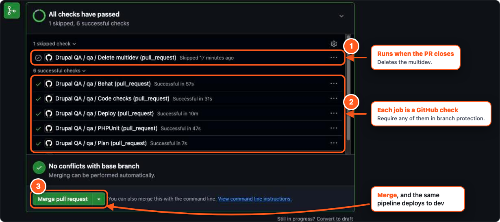

### Starting on an older site

Too many errors to start with? Nothing blocks a merge unless you ask, so a site with a
thousand PHPStan errors can still adopt drupal-qa today. When you want the checks to
mean something:

- **Turn a check off:** `skip: phpstan` or `skip: phpcs` in the workflow.
- **Start PHPStan lower:** add a `phpstan.neon` to the project root with `level: 0`. With
  your own file, CI uses it instead of ours, so it must list the paths.
- **Only count new errors:** a PHPStan *baseline* records today's errors once; from then
  on only errors that aren't in it are reported. Fix old ones whenever, and regenerate it
  to shrink it.

```neon
# phpstan.neon
includes:
  - vendor/thronedigital/drupal-qa/config/phpstan.neon.dist
  - phpstan-baseline.neon

parameters:
  level: 1                 # or 0 to start lower
  paths:
    - web/modules/custom
    - web/themes/custom
```

```bash
ddev exec vendor/bin/phpstan analyse --generate-baseline phpstan-baseline.neon
git add phpstan.neon phpstan-baseline.neon && git commit -m "chore: PHPStan baseline"
```

PHPCS can't be loosened: it always uses the Drupal standard, reports errors only and skips
line length. It warns unless required, or `skip: phpcs` turns it off.

## Adding your own tests

drupal-qa's tests check what every Drupal site needs. Yours check what your site
promises. Put a Behat feature in `tests/behat/features/` and it runs on the next pull
request's multidev, alongside the bundled scenarios:

```gherkin
Feature: Quotes
  Visitors can ask for a quote.

  Scenario: The quote page is ready
    When I go to "/quote"
    Then I should get a 200 HTTP response
    And I should see the button "Request a quote"
```

PHPUnit tests in `web/modules/custom/*/tests/src/Unit` and `.../Kernel` are found
automatically. A `behat.yml`, `phpstan.neon` or `phpunit.xml` of your own replaces the
package's.

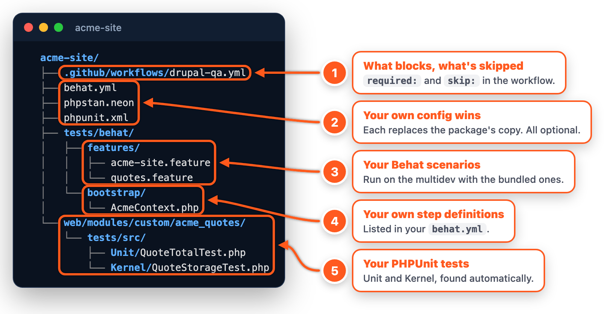

**[The guide to adding tests](docs/extending.md)** covers every step you can use,
logged-in scenarios, your own step definitions, PHPUnit, stricter config, and running
it all locally with ddev.

## Reference

<details>
<summary><b>Options</b>: make checks block, skip steps, no multidev</summary>

```yaml
    with:
      pantheon_site: my-site
      required: phpcs phpunit   # block instead of warn
      skip: behat               # don't run
      code_host: github-app     # Pantheon's GitHub App deploys; drupal-qa does the rest
      multidev: false           # below Gold: checks only on pull requests
```

| Option | Default | Meaning |
|---|---|---|
| `pantheon_site` | none | Site machine name. Not needed with `code_host: none`. |
| `required` | empty | Checks that fail their job instead of warning. |
| `skip` | empty | Steps that don't run. |
| `code_host` | `pantheon` | `pantheon` (drupal-qa pushes), `github-app` (Pantheon's app pushes), `none` (checks only). |
| `multidev` | `true` | Needs a Gold workspace or higher. |

Names: `phpcs phpstan yamllint audit secrets phpunit behat config status watchdog`;
`skip` also takes `updatedb` and `cim`. Detected, not configured: PHP version, code
paths, config directory, Commerce, and which module-specific tests apply.

</details>

<details>
<summary><b>Troubleshooting</b></summary>

| Message | Fix |
|---|---|
| Pantheon's bot protection challenges requests from CI | `terminus gcdn:bot-bypass <site>` must return a token for the token's account. |
| Could not create multidev pr-N | Delete an unused multidev, or set `multidev: false`. |
| Pantheon's master has commits this branch does not | Someone committed on Pantheon. `git pull <pantheon remote> master`, push to GitHub. |
| still serves the old file after 15 minutes | `git commit --allow-empty -m "chore: re-sync" && git push` |
| Log in to Pantheon fails on every run | The token expired. Make a new one and replace the secret. |
| Composer audit ⚠️ every time | `composer audit` names the package; update it. |
| drupal/core-dev is missing | `composer require --dev "drupal/core-dev:~<your core version>"`. |
| The page can be cached for visitors fails | Set "Browser and proxy cache maximum age" at /admin/config/development/performance (15 minutes or more), then export config. |
| Step "…" is already defined | Your `behat.yml` lists drupal-qa's `FeatureContext` and a class that extends it. List only yours: see [your own step definitions](docs/extending.md#your-own-step-definitions). |
| Behat ran no scenarios | Your `behat.yml` has no suite named `default`, or its paths find no features. |
| A new Pantheon site has `main` and `master` | Dev runs `master`. Use `master` as GitHub's default branch. |

</details>

<details>
<summary><b>Pantheon's GitHub App vs drupal-qa</b></summary>

Pantheon's [GitHub Application](https://docs.pantheon.io/guides/external-repositories/github)
(GA April 2026, Gold and up) makes your GitHub repository the site's repository:
merges to `main` deploy to dev and pull requests get multidevs. It moves **code**;
drupal-qa moves code **and checks the result**. They work together with
`code_host: github-app`.

| | GitHub App | drupal-qa |
|---|---|---|
| Existing sites | Chosen at site creation; no documented conversion | Any site |
| Multidev per PR | Yes | Yes |
| PHPCS, PHPStan, PHPUnit, secret scan | No | Yes |
| `updatedb`, `config:import` | Not documented | Yes |
| Smoke tests on the environment | No | Yes |
| Can stop a broken merge | No (no checks permission) | Yes, via `required` |
| Secrets | None | Two |

Pantheon's [`push-to-pantheon`](https://github.com/pantheon-systems/push-to-pantheon)
Action is still Early Access (0.9.6); pin 0.9.4 or later.

</details>

<details>
<summary><b>Upgrading from v1</b></summary>

The wizard upgrades v1 for you. By hand:

1. `composer require --dev thronedigital/drupal-qa:^2`
2. Delete `pr-checks.yml`, `multidev.yml`, `multidev-cleanup.yml` and
   `deploy-pantheon.yml`, and add the workflow from [Manual installation](#manual-installation), step 3.
   `phpcs_required: true` becomes `required: phpcs`; `run_behat: false` becomes
   `skip: behat`.
3. A v1 `behat.yml` probably needs its `base_url` removed.

</details>

<details>
<summary><b>Developing drupal-qa</b></summary>

- The wizard is `bin/drupal-qa-setup`, plain bash that runs on macOS's bash 3.2.
  `tests/setup/run.sh` drives it through every scenario with fake `terminus`, `gh`
  and `composer` (it needs `expect`); `tests/setup/run.sh fresh` runs one.
- The pipeline is `.github/workflows/pipeline.yml`; CI lints it with actionlint.
- The Behat steps are in `src/Behat/FeatureContext.php`, the bundled features in
  `tests/behat/features/`.

Sites use `@v2`, a tag that moves with every release:

```bash
git tag v2.0.3 && git tag -f v2 v2.0.3
git push origin v2.0.3 && git push -f origin v2
```

</details>

## Manual installation

Everything the wizard does, by hand. You need git, Composer (or ddev), and
[Terminus](https://docs.pantheon.io/terminal) and the [GitHub CLI](https://cli.github.com/),
both logged in.

**1. Get the site's code.** Already in the site's folder? Go to step 2. If the site lives only
in Pantheon's git, pull it down:

```bash
terminus local:clone my-site && cd ~/pantheon-local-copies/my-site
composer install
```

**2. Add the package**, with Drupal's own test tools matched to your core version:

```bash
composer require --dev thronedigital/drupal-qa "drupal/core-dev:~11.4.8"   # your core version
```

- drupal-qa needs PHP 8.2 or newer. If `composer.json` pins `config.platform.php` lower,
  raise it to the version Pantheon runs (`php_version` in `pantheon.yml`) first:
  `composer config platform.php 8.2`.
- If Composer refuses, run it again with `-W` so it can update the packages these depend
  on, and check what changed in `composer.lock` before you commit.

**3. Add the workflow.** Save this as `.github/workflows/drupal-qa.yml`, with your site's
machine name (`terminus site:list`) and your default branch (a clone of Pantheon's
repository uses `master`):

```yaml
name: Drupal QA

on:
  pull_request:
    types: [opened, synchronize, reopened, closed]
  push:
    branches: [main]          # your default branch

jobs:
  qa:
    permissions:              # new repositories let workflows only read;
      contents: read          # the results comment needs this write
      pull-requests: write
    uses: DanePete/drupal-qa/.github/workflows/pipeline.yml@v2
    with:
      pantheon_site: my-site
    secrets:
      PANTHEON_MACHINE_TOKEN: ${{ secrets.PANTHEON_MACHINE_TOKEN }}
      PANTHEON_SSH_KEY: ${{ secrets.PANTHEON_SSH_KEY }}
```

**4. Put the code on GitHub.** Skip this if the site already has a GitHub repository.

```bash
gh repo create my-org/my-site --private --source . --remote github --push
```

**5. Add the two secrets.** Both act as your Pantheon account, so add them only to
repositories you trust.

The token: open [your Pantheon user settings](https://dashboard.pantheon.io/personal-settings),
choose **Personal Access Tokens**, then **Add token**. Copy it; Pantheon shows it once, and it
expires after 90 days.

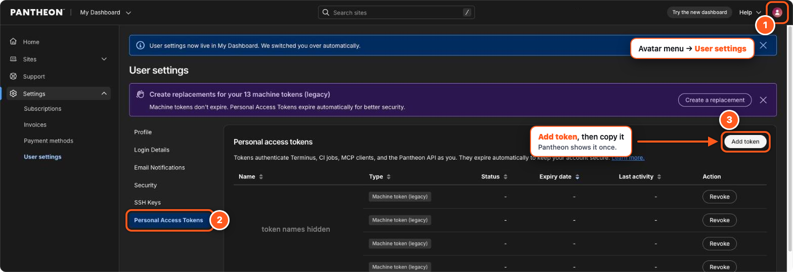

The SSH key: make an RSA key just for drupal-qa (Terminus refuses ed25519) and give Pantheon
its public half:

```bash
ssh-keygen -t rsa -b 4096 -m PEM -N "" -C "drupal-qa" -f ~/.ssh/drupal_qa
terminus ssh-key:add ~/.ssh/drupal_qa.pub
```

Or add it in the dashboard: **User settings**, **SSH Keys**, **Add New Key**, paste
`~/.ssh/drupal_qa.pub`.

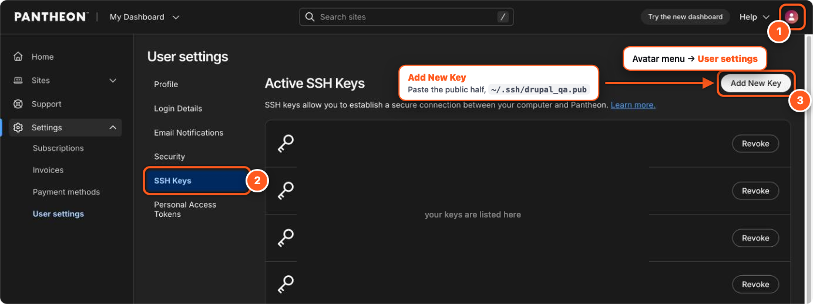

Then save both in the GitHub repository. `gh secret set` asks for the token without showing it:

```bash
gh secret set PANTHEON_MACHINE_TOKEN
gh secret set PANTHEON_SSH_KEY < ~/.ssh/drupal_qa
```

Or on GitHub: the repository's **Settings**, **Secrets and variables**, **Actions**, **New
repository secret**. The names must match exactly: `PANTHEON_MACHINE_TOKEN` holds the token,
`PANTHEON_SSH_KEY` the whole private key file.

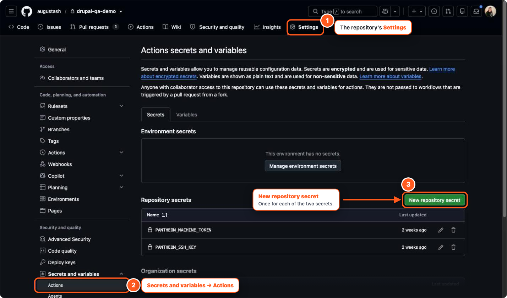

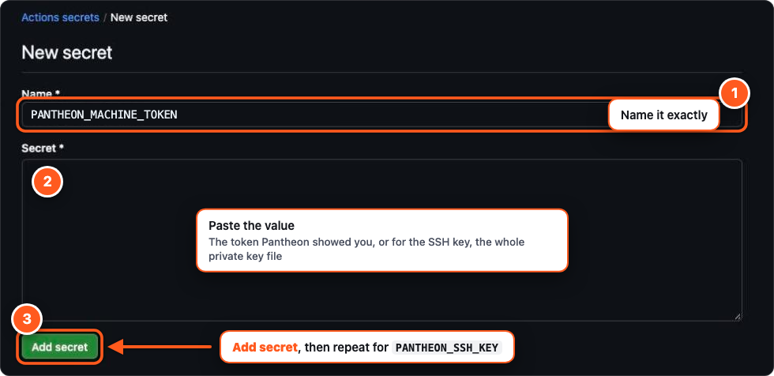

**6. Open a pull request.** Use the name of your GitHub remote: `github` if you made the
repository in step 4, usually `origin` otherwise.

```bash
git checkout -b chore/drupal-qa
git add composer.json composer.lock .github
git commit -m "chore: add drupal-qa"
git push -u github chore/drupal-qa && gh pr create --fill
```

**7. Watch the first run** under the repository's **Actions**. It takes 10 to 15 minutes, most
of it Pantheon building the pull request's multidev, then the results land on the pull request
as a comment with a link to the multidev.

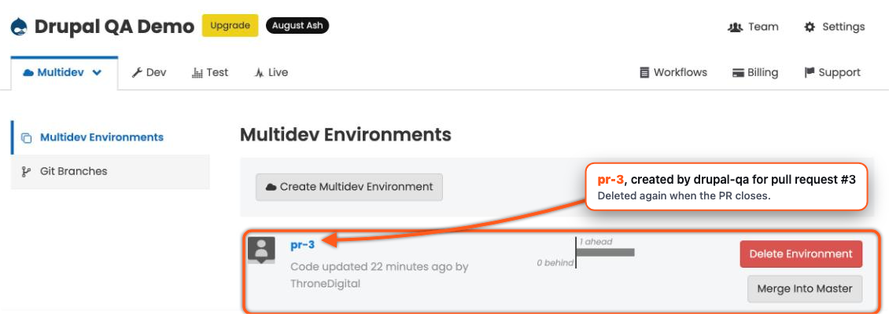

From then on, changes start on GitHub and drupal-qa pushes merges to Pantheon. Leave SFTP mode
off, and merge any dashboard or Autopilot commit into GitHub before the next deploy.

MIT licensed.
